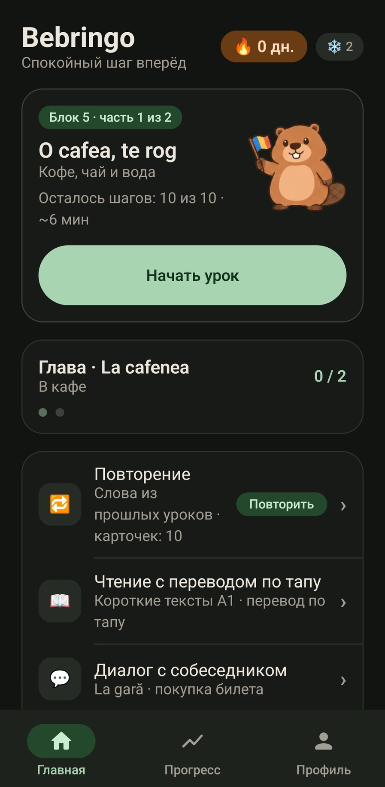
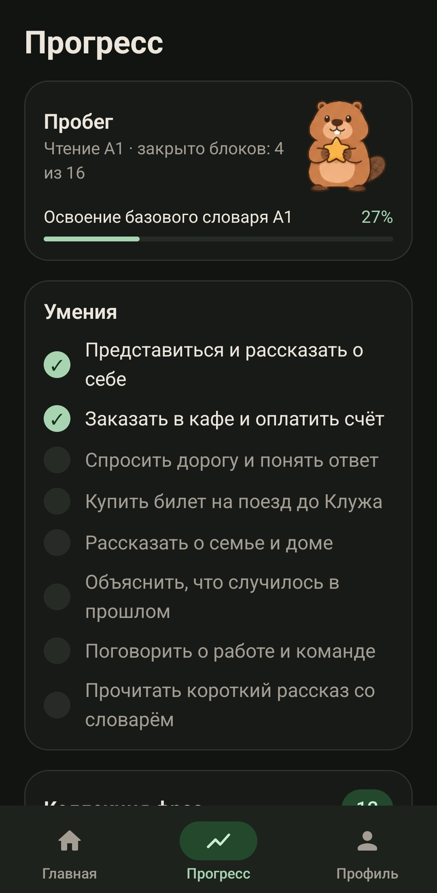
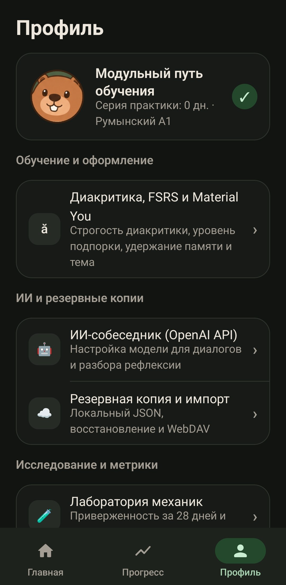

# Bebringo

[](LICENSE)
[](https://kotlinlang.org/)
[](https://developer.android.com/jetpack/compose)
[](#)

**Личный тренажёр румынского языка для Android: курс A1, интервальные повторения, озвучка и ИИ-собеседник.**

Приложение помогает учить румынский с русского: короткие уроки, повторение слов по FSRS,
стрик, чтение, диалоги с ИИ и резервные копии. Всё работает локально; данные не уходят
на сторонние серверы, кроме вашего собственного OpenAI-совместимого эндпоинта.

## Возможности

- **Курс A1** — 16 блоков, 8 глав, 73 леммы, 5 шагов в блоке; урок — сцена из 2 блоков
  (10 шагов).
- **Уроки** — 10 типов шагов, проверка ответов, разбор в конце; ошибка не возвращается
  в тот же урок.
- **Повторения на FSRS** — две карточки на слово, целевое удержание 90%; отдельная
  сессия «Повторение» на главной.
- **Стрик** — с двумя заморозками в месяц.
- **Озвучка** — офлайн-ассеты и системный TTS; звук можно выключить, автозапуск по
  умолчанию выключен.
- **ИИ-собеседник** — чат с носителем через свой OpenAI-совместимый эндпоинт.
- **Виджеты** — стрик 2×1 и слово дня 2×2.
- **Напоминания** — ежедневное уведомление в выбранное окно.
- **Бэкап** — JSON-файл и WebDAV, хранится 7 копий.
- **Телеметрия** — локально в SQLite, экспорт CSV.

## Скриншоты

<div align="center">



</div>

## Установка

### APK

1. Скачайте `bebringo-<version>.apk` из [GitHub Releases](https://github.com/Atte149/bebringo/releases).
2. Разрешите установку из неизвестных источников для файлового менеджера или браузера.
3. Установите APK.

Или через `adb`:

```bash
adb install -r bebringo-<version>.apk
```

Требования: **Android 8.0+** (`minSdk 26`).

### Сборка из исходников

Нужны JDK 17+ и Android SDK 35. В проекте есть Gradle wrapper:

```bash
git clone https://github.com/Atte149/bebringo.git
cd bebringo

export JAVA_HOME=<путь-к-jdk-17-или-21>
export ANDROID_HOME=<путь-к-android-sdk>

# debug-сборка
./gradlew assembleDebug
# APK: app/build/outputs/apk/debug/app-debug.apk

# unit-тесты (46 тестов, без устройства)
./gradlew testDebugUnitTest
```

Release-сборка требует ключ подписи. Пропишите в `~/.gradle/gradle.properties`:

```properties
APPS_KEYSTORE=/home/<user>/.android-signing/apps-release.jks
APPS_STORE_PASSWORD=<пароль-хранилища>
APPS_KEY_ALIAS=<alias>
APPS_KEY_PASSWORD=<пароль-ключа>
```

Затем:

```bash
./gradlew assembleRelease
# APK: app/build/outputs/apk/release/app-release.apk
```

Без `APPS_*` release-сборка не запустится: приложение требует подписанный APK для
установки и обновлений.

## Настройка

### Первый запуск

1. Пройдите онбординг: выберите цель на день, пройдите плейсмент и начните первый урок.
2. На **Главной** доступны урок, повторение, чтение с переводом по тапу и диалог
   с собеседником.
3. На **Прогрессе** видны освоение базового словаря A1, закрытые блоки и умения.
4. На **Профиле** — настройки обучения, ИИ, бэкапов и метрик.

### ИИ-собеседник

**Профиль → ИИ-собеседник (OpenAI API)**. Укажите:

- base URL OpenAI-совместимого эндпоинта;
- API-ключ;
- модель.

Ключ хранится локально на устройстве и используется только для запросов к указанному
эндпоинту.

### Бэкап и восстановление

**Профиль → Резервная копия и импорт**:

- локальный JSON-файл — экспорт/импорт;
- WebDAV — автоматические копии, хранится 7 версий.

### Обучение и оформление

**Профиль → Диакритика, FSRS и Material You**:

- строгость проверки диакритики;
- уровень подсказки;
- целевое удержание памяти для FSRS;
- тема приложения.

### Напоминания и звук

- Ежедневное напоминание настраивается в профиле; можно выбрать окно времени.
- Озвучка использует офлайн-ассеты и системный TTS; автозапуск звука по умолчанию выключен.

## Документация

Для разработки:

- [`docs/spec.md`](docs/spec.md) — спецификация продукта;
- [`docs/phases.md`](docs/phases.md) — журнал фаз и состояние MVP;
- [`docs/e2e.md`](docs/e2e.md) — E2E-сценарий приёмки;
- [`docs/tracks-architecture.md`](docs/tracks-architecture.md) — архитектура курса;
- [`docs/audio-and-tts.md`](docs/audio-and-tts.md) — озвучка;
- [`docs/ui-m3-and-widgets.md`](docs/ui-m3-and-widgets.md) — UI и виджеты.

## Лицензия

[MIT](LICENSE).
